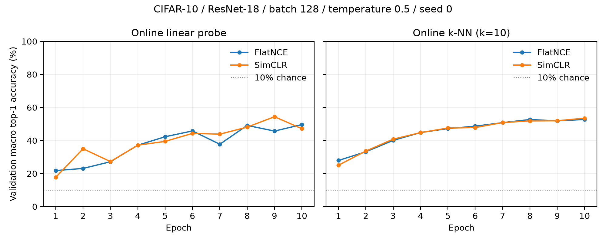

# Matched CIFAR-10 comparison

FlatNCE and SimCLR were trained for 10 epochs with an otherwise identical
recipe on October 21, 2026. Both runs completed all 3,510 updates on Apple M3
MPS with finite gradient and embedding diagnostics.

| Objective | Final online linear macro top-1 | Best online linear macro top-1 | Final online k-NN macro top-1 | Best online k-NN macro top-1 |
|---|---:|---:|---:|---:|
| FlatNCE | **49.63%** | 49.63% (epoch 10) | 52.72% | 52.72% (epoch 10) |
| SimCLR | 47.15% | **54.39% (epoch 9)** | **53.51%** | **53.51% (epoch 10)** |

The final linear result favors FlatNCE by 2.49 percentage points, while the
final k-NN result favors SimCLR by 0.79 points. The online linear curve is
noisy and SimCLR has the higher best-epoch linear value. These single-seed,
short-budget results show that both objectives learn useful representations;
they do not establish that either method is generally better.

Both runs used CIFAR-10 with a fixed 45,000/5,000 train/validation split,
ResNet-18 adapted for 32x32 inputs, a `512 -> 2048 -> 2048 -> 256` projector,
batch size 128, temperature 0.5, seed 0, float32, LARS with learning rate 5 and
weight decay `1e-6`, and step-based linear warmup followed by cosine decay.
The saved optimizer state confirms LARS momentum 0. The probes were trained
online and report macro top-1 accuracy; they are not frozen linear evaluation.
The official CIFAR-10 test split was not used.

The checked source data are in
[`results/cifar10-10ep-seed0`](results/cifar10-10ep-seed0): per-epoch CSV files,
the machine-readable comparison, PNG/PDF curves, and a portable experiment
manifest. The result exporter rejects incomplete update counts, missing epochs,
nonfinite diagnostics, synthetic data, and mismatched protocols.

Elapsed times are recorded for provenance only. Other checks ran concurrently
with part of the FlatNCE run, so these measurements are not a controlled speed
comparison. Reproducing the paper would require its longer training protocol,
multiple seeds and batch sizes, and separately trained frozen evaluation.
